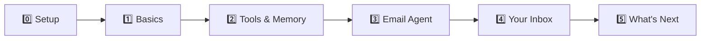

# 🕸️ LangGraph Workshop — Zero to Email Agent

A hands-on workshop repo: go from zero LangGraph knowledge to a working **email processing agent** — through levelled Jupyter notebooks (open locally or in Colab), with a companion Vue website that renders the teaching docs and lets you configure your LLM credentials once (base URL, API key, model) and reuse them everywhere.

**Site:** https://abhijeet1520.github.io/langgraph-workshop/ · **Repo:** https://github.com/Abhijeet1520/langgraph-workshop

## The Journey



| Level | Folder | What you learn |
|---|---|---|
| 0 | [notebooks/level-0-setup](notebooks/level-0-setup/) | Install the stack, configure any LLM provider (instructor endpoint, OpenRouter, Hugging Face, Anthropic, ...) |
| 1 | [notebooks/level-1-basics](notebooks/level-1-basics/) | StateGraph, nodes, edges, routing, loops |
| 2 | [notebooks/level-2-tools-memory-capstone](notebooks/level-2-tools-memory-capstone/) | Tools, memory/checkpointing, research-assistant capstone |
| 3 | [notebooks/level-3-email-agent](notebooks/level-3-email-agent/) | Build the email processing agent (classify → respond) |
| 4 | [notebooks/level-4-real-inbox](notebooks/level-4-real-inbox/) | Point the agent at your real inbox (IMAP/Gmail) |
| 5 | [docs/levels/level-5-next-steps](docs/levels/level-5-next-steps/) | What else can you automate? (closing slides) |

## Quick Start (pick one)

1. **Run in Colab (zero install)** — open any notebook's Colab badge, then do the provider setup once:
   [docs/setup/colab.md](docs/setup/colab.md)
2. **Run locally** — clone, create a venv, install, set env vars:
   [docs/setup/local.md](docs/setup/local.md)
3. **Follow along on the site** — the workshop website walks the same levels, renders every doc, and has the settings panel where you paste your credentials (it also shows the env-var commands to paste into Colab/local shells).
   [docs/setup/website.md](docs/setup/website.md)

Whichever you choose, you'll need a **base URL + API key + model name** — see
[docs/setup/providers.md](docs/setup/providers.md) for all supported scenarios (instructor endpoint, OpenRouter, Hugging Face, Anthropic, and OpenAI-compatible proxies in general).

## Repo Layout

```
langgraph-workshop/
├── docs/
│   ├── levels/level-{0..5}-*/        # teaching docs per level (rendered by the site)
│   ├── setup/                        # local / colab / providers / website how-tos
│   └── curriculum.json               # level+task ordering, Colab links, provenance
├── notebooks/
│   └── level-{0..4}-*/               # the curriculum notebooks
├── scripts/                          # migration + verification helpers
├── site/                             # Vue 3 + Vite workshop website
└── .github/workflows/                # deploy site to GitHub Pages
```

## Credits & Sources

Notebooks and docs are migrated from (and credited to) the sources tracked in
[docs/PROVENANCE.md](docs/PROVENANCE.md).

## License

MIT
