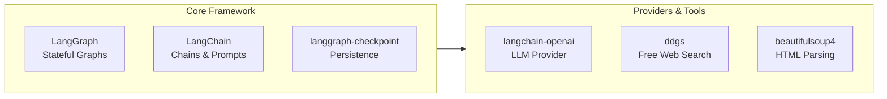

> **Source:** migrated from [`docs/task1-setup.md`](https://github.com/Abhijeet1520/LangGraph-Basics/blob/main/docs/task1-setup.md) (Abhijeet1520/LangGraph-Basics). See [PROVENANCE.md](../../PROVENANCE.md) for the full mapping.

# Task 1 - Setup: Install the LangGraph Ecosystem

> **Goal:** Get a working Python environment with LangGraph, LangChain, an LLM provider, and search tooling installed.

## Stack Overview



| Package | Purpose |
|---|---|
| `langgraph` | Stateful graph orchestration |
| `langchain`, `langchain-core`, `langchain-community` | Chains, prompts, community integrations |
| `langchain-openai` | OpenAI-compatible LLM access |
| `langgraph-checkpoint` | State persistence / memory |
| `ddgs` | DuckDuckGo search (no API key) |
| `beautifulsoup4`, `requests` | Web scraping helpers |
| `python-dotenv`, `pydantic` | Config & data validation |

## Installation

```bash
cd /root && mkdir -p langgraph-lab && cd langgraph-lab
python3 -m venv venv && source venv/bin/activate
pip install --upgrade pip uv

# Core LangGraph and LangChain packages
uv pip install langgraph langchain langchain-core langchain-community

# LLM Providers and State Management
uv pip install langchain-openai langgraph-checkpoint

# Research Tools and Utilities (DuckDuckGo is FREE - no API key!)
uv pip install ddgs beautifulsoup4 requests python-dotenv pydantic typing-extensions

echo "LANGGRAPH_INSTALLED" > /root/langgraph-ready.txt
```

## Proxy Configuration

All model IDs in this lab are served via an OpenAI-compatible proxy. Model names like `openai/gpt-4.1-mini` are aliases configured in the proxy server. Set these environment variables before running the demos:

```bash
export OPENAI_API_KEY="<your-key>"
export OPENAI_API_BASE="<proxy-base-url>"
export OPENAI_MODEL="openai/gpt-4.1-mini"
```

## Verify

```bash
python -c "import langgraph, langchain, langchain_openai, ddgs; print('OK')"
cat /root/langgraph-ready.txt
```

✅ **Done when:** the import check prints `OK` and the marker file exists.
