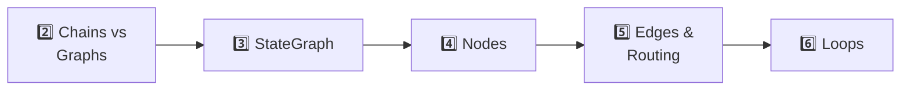

# Level 1 — LangGraph Basics

> **Goal:** the core mental model — state, nodes, edges, routing, loops. After this level, "graph" is the natural way you think about agent workflows.

## The journey

## Docs (the teaching text)

| Task | Concept | Doc |
|---|---|---|
| 2 | Sequential vs stateful — why graphs beat chains | [task2-sequential-vs-stateful.md](task2-sequential-vs-stateful.md) |
| 3 | StateGraph — typed state that persists | [task3-stategraph.md](task3-stategraph.md) |
| 4 | Nodes — workflow worker functions | [task4-nodes.md](task4-nodes.md) |
| 5 | Edges & routing — conditional paths | [task5-edges-routing.md](task5-edges-routing.md) |
| 6 | Loops — iterative refinement | [task6-loops.md](task6-loops.md) |

## Notebooks (the practice)

| # | Notebook | Topic |
|---|---|---|
| 01 | [01_introduction.ipynb](../../notebooks/level-1-basics/01_introduction.ipynb) | LangGraph concepts & architecture |
| 02 | [02_simple_graph.ipynb](../../notebooks/level-1-basics/02_simple_graph.ipynb) | Build & run a simple graph |
| 03 | [03_more_on_states.ipynb](../../notebooks/level-1-basics/03_more_on_states.ipynb) | State schemas deep-dive |
| 04 | [04_chat_tool_graph.ipynb](../../notebooks/level-1-basics/04_chat_tool_graph.ipynb) | Chat + tool graph |
| 05 | [05_basic_agent.ipynb](../../notebooks/level-1-basics/05_basic_agent.ipynb) | First agent |
| 06 | [06_agent_memory_checkpointing.ipynb](../../notebooks/level-1-basics/06_agent_memory_checkpointing.ipynb) | Memory & checkpointing |
| 07 | [07_controllability_breakpoints_timetravel.ipynb](../../notebooks/level-1-basics/07_controllability_breakpoints_timetravel.ipynb) | Breakpoints & time travel |
| 08 | [08_parallelization_subgraph.ipynb](../../notebooks/level-1-basics/08_parallelization_subgraph.ipynb) | Parallelization & subgraphs |
| 09 | [09_more_on_messages.ipynb](../../notebooks/level-1-basics/09_more_on_messages.ipynb) | Message types & flow |
| 10 | [10_chatbot_summarization_stream.ipynb](../../notebooks/level-1-basics/10_chatbot_summarization_stream.ipynb) | Summarization & streaming |

## Order

Docs and notebooks cross-reference: read the task doc, then run the matching notebook. A solid minimum: **task2–6 docs + notebooks 01, 02, 03, 05** — then you're ready for [Level 2](../level-2-tools-memory-capstone/README.md).
