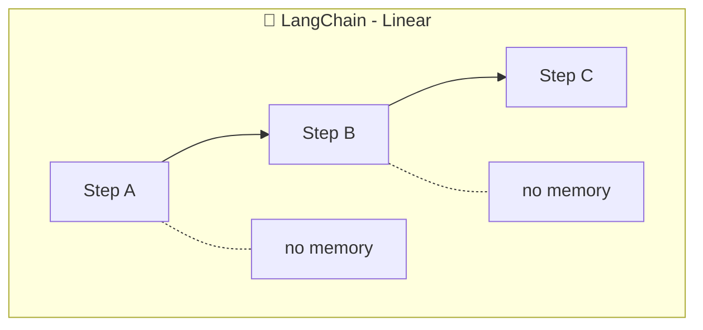
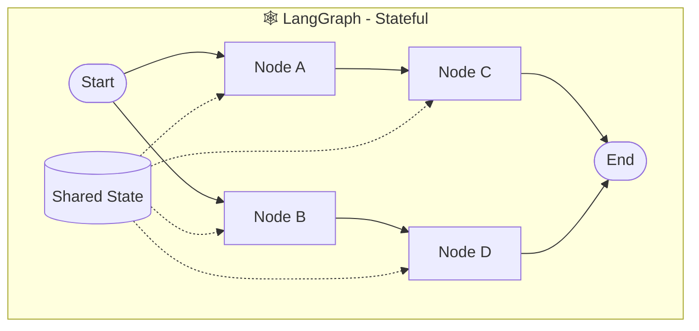

> **Source:** migrated from [`docs/task2-sequential-vs-stateful.md`](https://github.com/Abhijeet1520/LangGraph-Basics/blob/main/docs/task2-sequential-vs-stateful.md) (Abhijeet1520/LangGraph-Basics). See [PROVENANCE.md](../../PROVENANCE.md) for the full mapping.

# Task 2 - Sequential vs Stateful: Why Graphs Matter

> **Goal:** Experience the difference between a linear LangChain chain (no memory) and a LangGraph stateful graph (built-in memory).

## The Key Difference

Chains process steps **independently** - like a factory line where each station forgets the previous one. Graphs maintain **shared state** - like a GPS that remembers your whole route and recalculates with live traffic.





## Files in This Task

| File | What it shows |
|---|---|
| [sequential_chain.py](../task2/sequential_chain.py) | Two LLM calls in a row - step 2 can't see step 1's data |
| [stateful_graph.py](../task2/stateful_graph.py) | Same flow as a graph - step 2 reads the name saved by step 1 |
| [compare_approaches.py](../task2/compare_approaches.py) | Side-by-side comparison table |

## Run It

```bash
python /root/code/task2/sequential_chain.py   # Step 2 forgets "Alice"
python /root/code/task2/stateful_graph.py   # Step 2 remembers "Alice"
python /root/code/task2/compare_approaches.py
```

## What Happens

**Sequential chain** - each `prompt | llm` call is independent:

```py
chain1 = prompt1 | llm
greeting = chain1.invoke({"name": name})   # knows "Alice"

chain2 = prompt2 | llm
farewell = chain2.invoke({})               # has NO idea who Alice is
```

**Stateful graph** - state flows through every node:

```py
class ConversationState(TypedDict):
    name: str
    greeting: str
    farewell: str

def greet_person(state):
    # reads state["name"], writes greeting back into state
    return {"greeting": greeting}

def say_farewell(state):
    # state["name"] is still there!
    ...
```

## Comparison

| Feature | Sequential | Stateful |
|---|---|---|
| Memory | ❌ None | ✅ Preserved |
| Between Steps | Independent | Connected |
| Complexity | Simple | Flexible |
| Use Case | One-time tasks | Conversations |

## 💡 Takeaway

- **Sequential:** every step starts fresh - you must manually thread data through.
- **Stateful:** steps share a `TypedDict` state - the graph is your memory.

✅ **Done when:** you can explain why the sequential demo fails the memory test while the graph passes it.
