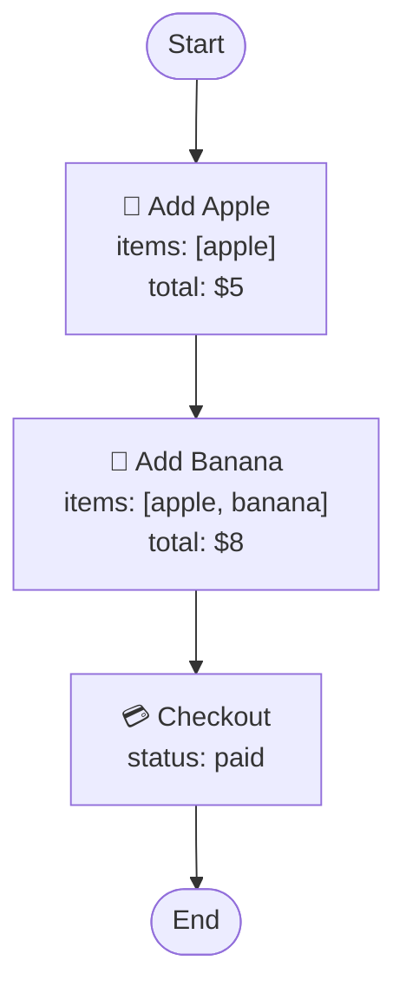
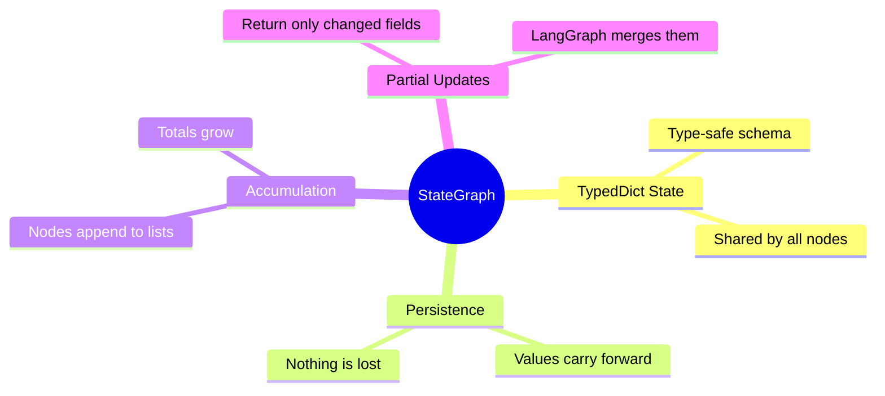

> **Source:** migrated from [`docs/task3-stategraph.md`](https://github.com/Abhijeet1520/LangGraph-Basics/blob/main/docs/task3-stategraph.md) (Abhijeet1520/LangGraph-Basics). See [PROVENANCE.md](../../PROVENANCE.md) for the full mapping.

# Task 3 - StateGraph: The Heart of LangGraph

> **Goal:** Learn how a `StateGraph` manages data that persists and accumulates across every node - like a shopping cart that remembers items as you add them.

## Shopping Cart Walkthrough



## Core Concepts



## The File

[task3/stategraph_demo.py](../task3/stategraph_demo.py) builds a 3-node cart:

```py
class CartState(TypedDict):
    items: List[str]
    total: float
    status: str

def add_apple(state: CartState):
    return {
        "items": state["items"] + ["apple"],   # accumulate
        "total": state["total"] + 5            # accumulate
    }

workflow = StateGraph(CartState)
workflow.add_node("add_apple", add_apple)
workflow.add_node("add_banana", add_banana)
workflow.add_node("checkout", checkout)
workflow.set_entry_point("add_apple")
workflow.add_edge("add_apple", "add_banana")
workflow.add_edge("add_banana", "checkout")
workflow.add_edge("checkout", END)
```

## Run It

```bash
python /root/code/task3/stategraph_demo.py
```

Expected flow:

1. Initial state: `{'items': [], 'total': 0.0, 'status': 'pending'}`
2. After apple: `items=['apple'], total=$5`
3. After banana: `items=['apple','banana'], total=$8`
4. After checkout: `status='paid'`

## 💡 Key Insights

- State **persists** across all nodes - nothing resets between steps.
- Each node returns a **partial update**; LangGraph merges it into the full state.
- Nodes **accumulate** (append to lists, add to totals) rather than overwrite.

✅ **Done when:** you can predict the state after each node before running the demo.
