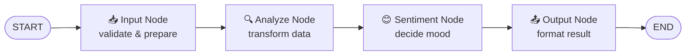
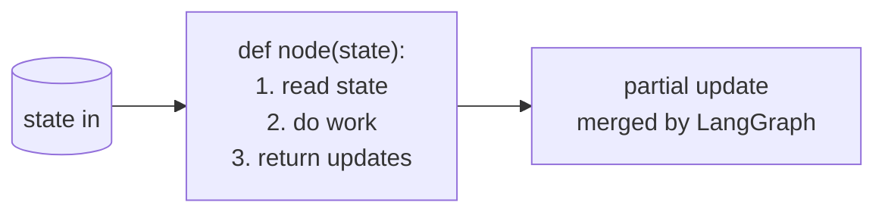

# Task 4 - Nodes: Your Workflow Workers

> **Goal:** Understand nodes as specialized workers - each a function that reads state, does one job, and returns updates.

## Node Pipeline



## Anatomy of a Node

Every node follows the same contract:



```py
def simple_node(state):
    data = state["data"]        # 1. read
    result = data.upper()       # 2. process
    return {"result": result}   # 3. return updates
```

## The Four Node Types

### 1️⃣ Simple Function Node
```py
def simple_node(state):
    return {"result": state["data"].upper()}
```

### 2️⃣ LLM-Powered Node
```py
def llm_node(state):
    response = llm.invoke(state["prompt"])
    return {"ai_response": response}
```

### 3️⃣ Tool-Using Node
```py
def tool_node(state):
    results = search_tool(state["query"])
    return {"search_results": results}
```

### 4️⃣ Conditional Node
```py
def router_node(state):
    return {"route": "success" if state["score"] > 0.8 else "retry"}
```

## The File

[task4/nodes_demo.py](../../../demos/task4/nodes_demo.py) wires four nodes into a text-analysis pipeline:

```py
workflow.add_node("input", input_node)        # validates text
workflow.add_node("analyze", analyze_node)    # counts words
workflow.add_node("sentiment", sentiment_node) # detects mood
workflow.add_node("output", output_node)      # formats report

workflow.add_edge(START, "input")
workflow.add_edge("input", "analyze")
workflow.add_edge("analyze", "sentiment")
workflow.add_edge("sentiment", "output")
workflow.add_edge("output", END)
```

It runs three test inputs - positive, negative, and neutral - and prints a formatted analysis for each.

## Run It

```bash
python /root/code/task4/nodes_demo.py
```

## 💡 Key Insights

| Node | Role |
|---|---|
| Input | Validates and prepares data |
| Analyze | Processes and transforms data |
| Sentiment | Makes decisions based on state |
| Output | Formats and presents results |

- Nodes are **pure workers**: state in → updates out.
- Keep each node **small and single-purpose** - compose behavior from many nodes.

✅ **Done when:** you can write a new node (e.g., a "translator" node) and insert it into the pipeline.
