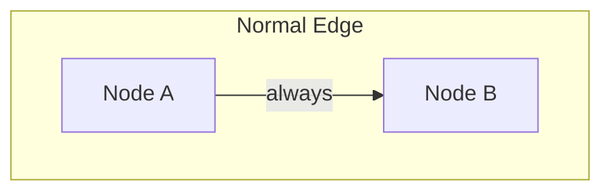
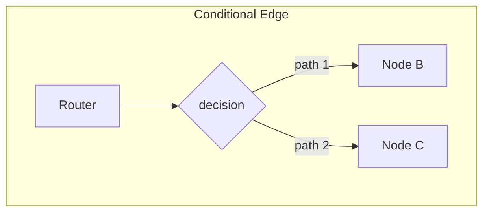
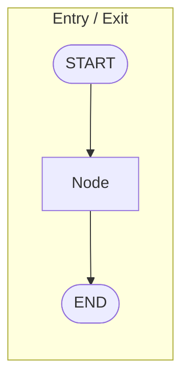
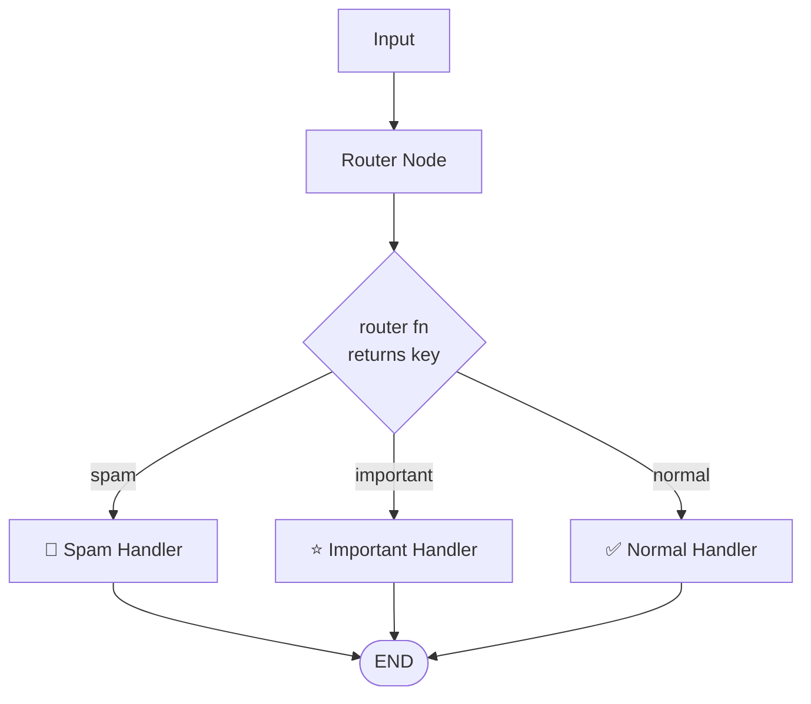

# Task 5 - Edges & Routing: Controlling Your Workflow 🛤️

> **Goal:** Master the three kinds of edges - normal, conditional, and entry/exit - and use router functions to make your graph choose paths dynamically.

## Edge Types at a Glance







## How Conditional Routing Works



## Edge Methods

### `add_edge()` - fixed flow
```py
workflow.add_edge("node_a", "node_b")
workflow.add_edge(START, "first")
workflow.add_edge("last", END)
```

### `add_conditional_edges()` - dynamic flow
```py
def router(state):
    if state["score"] > 0.5:
        return "success"
    return "retry"

workflow.add_conditional_edges(
    "check", router,
    {"success": "done", "retry": "fix"}
)
```

## Router Patterns

```py
# Binary decision
def binary_router(state):
    return "yes" if valid else "no"

# Multi-path
def category_router(state):
    return state["category"]

# Priority-based
def priority_router(state):
    if urgent: return "fast"
    return "normal"
```

## The File

[task5/edges_routing_demo.py](../task5/edges_routing_demo.py) builds an email processor:

```py
def email_router(state) -> Literal["spam", "important", "normal"]:
    if state["spam_score"] > 0.6:
        return "spam"
    elif "urgent" in state["email_text"].lower():
        return "important"
    return "normal"

workflow.add_edge(START, "analyze")
workflow.add_conditional_edges("analyze", email_router, {
    "spam": "spam",
    "important": "important",
    "normal": "normal"
})
workflow.add_edge("spam", END)
workflow.add_edge("important", END)
workflow.add_edge("normal", END)
```

## Run It

```bash
python /root/code/task5/edges_routing_demo.py
```

Four test emails get routed: a meeting note → inbox, a "FREE prize" message → spam, an urgent alert → high priority, cat photos → inbox.

## 💡 Key Insights

- **Normal edges** define fixed flow (`START→analyze`, handlers→`END`).
- **Conditional edges** evaluate a router function against the state and pick a path.
- A router returns a **key**; the mapping dict translates keys to node names.
- Multiple paths can **converge** at `END`.

✅ **Done when:** you can add a fourth route (e.g., `"newsletter"`) with its own handler node.
