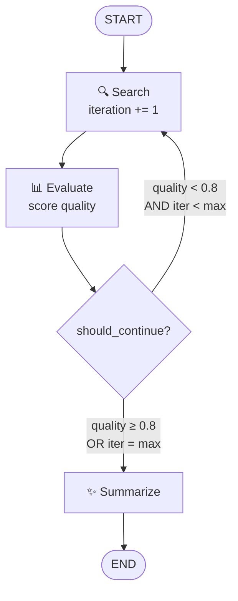

# Task 6 - Loops & Iterations: Refining Your Research

> **Goal:** Make a graph loop back on itself - refining search results until quality is good enough or a max-iteration safety limit kicks in.

## Why Loops Matter

One search is rarely enough. Loops let a workflow:

- Refine queries based on initial results
- Gather more information when needed
- Validate findings before proceeding

## The Refinement Loop



## Building a Loop

A loop is just a conditional edge whose mapping points **back** to an earlier node:

```py
def should_continue(state):
    '''Router function: decides loop or end'''
    if state["iteration"] < 3 and state["quality"] < 0.7:
        return "search"   # loop back
    return "end"          # exit loop

workflow.add_conditional_edges(
    "evaluate",
    should_continue,
    {
        "search": "search",   # ⬅️ edge back to search = LOOP
        "end": END
    }
)
```

## Loop Control Strategies

### 1. Counter-Based
```py
if state["iteration"] < MAX_ITERATIONS:
    return "continue"
```

### 2. Quality-Based
```py
if state["confidence_score"] < THRESHOLD:
    return "refine_search"
```

### 3. Content-Based
```py
if "need more info" in state["analysis"]:
    return "gather_more"
```

## The File

[task6/loops_demo.py](../task6/loops_demo.py) simulates a search that improves each iteration:

```py
workflow.add_edge(START, "search")
workflow.add_edge("search", "evaluate")
workflow.add_conditional_edges(
    "evaluate", should_continue,
    {"search": "search", "summarize": "summarize"}
)
workflow.add_edge("summarize", END)
```

The router exits when `quality_score >= 0.8` **or** `iteration >= max_iterations` (3).

## Run It

```bash
python /root/code/task6/loops_demo.py
```

Watch quality climb: `0.3 → 0.6 → 0.9`, then the loop exits and the LLM summarizes.

## 💡 Key Insights

1. Loops enable **iterative refinement**.
2. Router functions control loop flow.
3. **Always set max iterations** to prevent infinite loops.
4. Quality thresholds provide early exit.
5. State **accumulates** through iterations.

✅ **Done when:** you can explain both exit conditions and why each is necessary.
