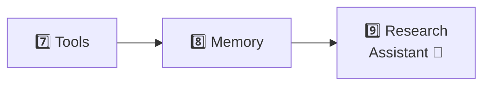
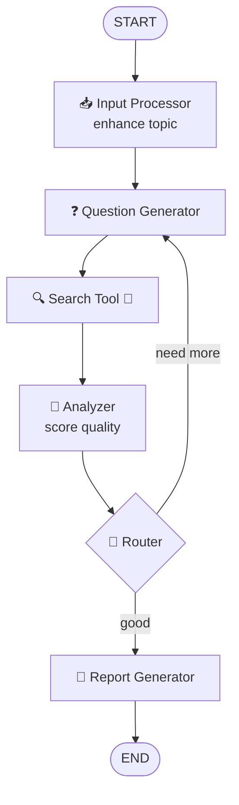

# Level 2 — Tools, Memory & the Capstone

> **Goal:** give agents superpowers — real tools (web search), persistent memory, and a full research assistant that combines everything.

## The journey

## Docs (the teaching text)

| Task | Concept | Doc |
|---|---|---|
| 7 | Tools — DuckDuckGo search, function calling | [task7-tools.md](task7-tools.md) |
| 8 | Memory — checkpointing across turns | [task8-memory.md](task8-memory.md) |
| 9 | Capstone — the research assistant | [task9-research-assistant.md](task9-research-assistant.md) |

## Notebooks (the practice)

| # | Notebook | Topic |
|---|---|---|
| 11 | [11_research_assistant.ipynb](../../notebooks/level-2-tools-memory-capstone/11_research_assistant.ipynb) | Research assistant capstone |
| 12 | [12_memory.ipynb](../../notebooks/level-2-tools-memory-capstone/12_memory.ipynb) | Memory architectures |
| 13 | [13_memory_profile_collection.ipynb](../../notebooks/level-2-tools-memory-capstone/13_memory_profile_collection.ipynb) | Memory: profiles & collections |
| 14 | [14_chatbot_agent.ipynb](../../notebooks/level-2-tools-memory-capstone/14_chatbot_agent.ipynb) | Chatbot agent end-to-end |

## The capstone architecture

## Coming next

With graphs, tools and memory in hand → [Level 3 — the Email Automation Agent](../level-3-email-agent/README.md).
