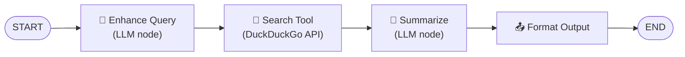

# Task 7 - Tool Integration: Adding Search Capabilities

> **Goal:** Turn external services into nodes. Here: wire DuckDuckGo web search into a LangGraph workflow - no API key needed.

## Tool Pipeline



## Why DuckDuckGo?

| ✅ | Benefit |
|---|---|
| Free | No API key required |
| Simple | `DDGS().text(query)` returns results |
| Reliable | Works consistently |
| Private | Doesn't track searches |

## The Tool Node Pattern

A tool node is just a regular node that calls an external service:

```py
def tool_node(state):
    # 1. Extract parameters from state
    query = state["enhanced_query"] or state["query"]
    # 2. Call external tool/API
    results = DDGS().text(query, max_results=3)
    # 3. Process results
    formatted = [f"{r['title']}: {r['body']}" for r in results]
    # 4. Return state updates
    return {"search_results": formatted}
```

## The File

[task7/tools_demo.py](../task7/tools_demo.py) chains four nodes:

```py
workflow.add_node("enhance_query", enhance_query_node)  # LLM improves query
workflow.add_node("search_tool", search_tool_node)      # 🦆 TOOL NODE
workflow.add_node("summarize", summarize_node)          # LLM condenses
workflow.add_node("format", format_output_node)         # pretty print

workflow.add_edge(START, "enhance_query")
workflow.add_edge("enhance_query", "search_tool")
workflow.add_edge("search_tool", "summarize")
workflow.add_edge("summarize", "format")
workflow.add_edge("format", END)
```

Note the **error handling** in the tool node - external calls can fail:

```py
try:
    results = ddgs.text(query, max_results=3)
except Exception as e:
    search_results = [f"Search error: {e}. Using fallback data."]
```

## Run It

```bash
python /root/code/task7/tools_demo.py
```

Three test queries get enhanced → searched → summarized with live web data.

## 💡 Key Insights

1. Tools are just **special nodes** that interact with external services.
2. DuckDuckGo is free and requires no API key.
3. Tool nodes **can fail** - always handle errors gracefully.
4. Combine tools with LLM nodes for enhanced functionality.
5. Tools extend LangGraph beyond pure LLM calls.

✅ **Done when:** you can sketch a new tool node (e.g., a calculator or database lookup) following the 4-step pattern.
