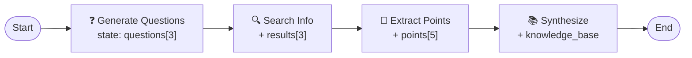

# Task 8 - Memory & State: Building Knowledge

> **Goal:** Treat state as long-term memory - each node reads the accumulated knowledge of all previous nodes and adds its own contribution.

## Knowledge Accumulation Flow



State **grows** at every step - nothing is thrown away until the final synthesis.

## The Accumulation Pattern

```py
from typing import TypedDict, List

class MemoryState(TypedDict):
    questions: List[str]       # accumulates
    search_results: List[str]  # accumulates
    key_points: List[str]      # accumulates
    final_report: str          # final synthesis

def accumulator_node(state: MemoryState):
    # 1. Read existing data
    existing_points = state.get("key_points", [])
    # 2. Generate new data
    new_points = ["Point 1", "Point 2"]
    # 3. Accumulate (combine)
    all_points = existing_points + new_points
    # 4. Return accumulated state
    return {"key_points": all_points}
```

## Memory Strategies

### 1. List Accumulation
```py
items = state.get("items", [])
items.append(new_item)
return {"items": items}
```

### 2. Counter Tracking
```py
return {"count": state["count"] + 1}
```

### 3. Knowledge Building
```py
return {"knowledge": state["knowledge"] + new_facts}
```

## The File

[task8/memory_demo.py](../../../demos/task8/memory_demo.py) runs a mini research pipeline:

```py
workflow.add_node("questions", generate_questions_node)   # +3 questions
workflow.add_node("search", search_node)                  # +3 results
workflow.add_node("extract", extract_key_points_node)     # +5 key points
workflow.add_node("synthesize", build_knowledge_base_node) # → knowledge base
workflow.add_node("display", display_memory_state)        # show everything
```

Every node also bumps an `operations_count` counter - a second memory dimension.

## Run It

```bash
python /root/code/task8/memory_demo.py
```

Two topics are researched; each ends with a full state summary: 3 questions, 3 results, 5 key points, and a synthesized knowledge base (~4–5k chars).

## 💡 Key Insights

1. State **persists** across all nodes in the workflow.
2. Lists and collections can **accumulate** data.
3. Each node can **read and add** to existing state.
4. State acts as the workflow's **memory**.
5. Final nodes can **synthesize** accumulated knowledge.

✅ **Done when:** you can add a new accumulating field (e.g., `sources: List[str]`) and have it flow through every node.
