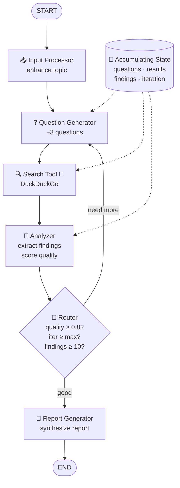

# Task 9 - Build Your Research Assistant 🤖

> **Goal:** Combine everything - StateGraph, nodes, edges, routing, loops, tools, and memory - into a complete AI Research Assistant.

## Full Architecture



## The State

```py
class ResearchState(TypedDict):
    topic: str
    research_questions: List[str]
    search_queries: List[str]
    search_results: List[str]
    key_findings: List[str]
    iteration: int
    max_iterations: int
    quality_score: float
    final_report: str
    status: str
```

## The Nodes

| Node | Role |
|---|---|
| `input_processor_node` | Enhances the raw topic into a focused research question |
| `question_generator_node` | LLM generates 3 searchable questions (accumulating) |
| `search_tool_node` | DuckDuckGo search per question, skipping duplicates |
| `analyzer_node` | LLM extracts 5 findings; computes quality score |
| `report_generator_node` | LLM writes Executive Summary → Key Findings → Conclusion |

## The Router

```py
def should_continue_research(state) -> Literal["search", "report"]:
    if state["iteration"] >= state["max_iterations"]:
        return "report"
    if state["quality_score"] >= 0.8:
        return "report"
    if len(state.get("key_findings", [])) >= 10:
        return "report"
    return "search"   # loops back to question generator
```

Three exit conditions: max iterations, quality threshold, enough findings.

## Wiring It Together

```py
workflow.add_edge(START, "input")
workflow.add_edge("input", "questions")
workflow.add_edge("questions", "search")
workflow.add_edge("search", "analyze")
workflow.add_conditional_edges("analyze", should_continue_research, {
    "search": "questions",   # loop back
    "report": "report"
})
workflow.add_edge("report", END)

assistant = workflow.compile()
result = assistant.invoke(initial_state)
```

## Run It

```bash
# CLI version
python /root/code/task9/research_assistant.py

# Web UI version
uv pip install streamlit
streamlit run /root/code/task9/streamlit_app.py
```

## Streamlit Web Interface

[task9/streamlit_app.py](../task9/streamlit_app.py) adds:

- **Real-time visualization** - watch nodes execute live with progress tracking
- **Interactive controls** - adjust max iterations and quality threshold
- **Tabbed results** - Report / Questions / Searches / Findings / Metadata
- **State inspector** - view the complete state at any point
- **Export** - download reports as Markdown

## 💡 What Your Assistant Does

1. Accepts a research topic
2. Generates intelligent research questions
3. Searches the web using DuckDuckGo
4. Analyzes and extracts key findings
5. Loops to gather more information if needed
6. Generates a comprehensive research report

## 🎓 Concepts Combined

✅ StateGraph - workflow management
✅ Nodes - processing steps
✅ Edges & Routing - flow control
✅ Loops - iterative refinement
✅ Tools - DuckDuckGo search
✅ Memory - state accumulation

✅ **Done when:** the assistant produces a full report with metadata for a topic of your choosing.

## 🚀 Next Steps

- Add more tools (Wikipedia, arXiv, news APIs)
- Persist state across runs with `langgraph-checkpoint`
- Add human-in-the-loop approval before report generation
- Parallelize searches with `Send` / fan-out edges
