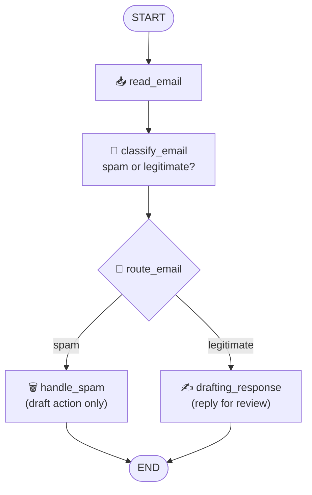

# Level 3 — Email Automation Agent

> **Goal:** build a real agent — an email processing butler that reads mail, classifies spam vs legitimate, and drafts replies. This is where everything from Levels 1–2 combines into one applied system.

## What you build



The state is the story — one typed dict the whole graph shares:

```py
class EmailState(TypedDict):
    email: Dict[str, Any]           # the email itself
    is_spam: Optional[bool]         # classification result
    draft_response: Optional[str]   # LLM-drafted reply
    messages: List[Dict[str, Any]]  # running LLM transcript
```

## The notebooks

| Notebook | What it covers | Requires |
|---|---|---|
| [30_email_agent_graph.ipynb](../../../notebooks/level-3-email-agent/30_email_agent_graph.ipynb) | The full graph: nodes, conditional routing, compile, run on two sample emails | Levels 1–2 |
| [31_email_agent_observability.ipynb](../../../notebooks/level-3-email-agent/31_email_agent_observability.ipynb) | **Optional advanced:** Langfuse tracing, online evaluation (costs, latency, LLM-as-judge), dataset evaluation | A free [Langfuse](https://langfuse.com) account |

## The two sample emails (for now)

The graph runs on two hardcoded Batman-themed samples — a threatening letter from the Joker (legitimate) and a crypto pitch (spam):

```python
legitimate_email = {
    "sender": "Joker",
    "subject": "Found you Batman ! ",
    "body": "Mr. Wayne, I found your secret identity ! ..."
}
spam_email = {
    "sender": "Crypto bro",
    "subject": "The best investment of 2025",
    "body": "Mr Wayne, I just launched an ALT coin and want you to buy some !"
}
```

They're toys on purpose — **Level 4 replaces them with your real inbox**, running the *same graph unchanged*.

## Key concepts

- **State as contract:** nodes read from and write to `EmailState` — the graph structure stays identical regardless of where emails come from.
- **Conditional edges:** `route_email` reads `is_spam` and picks the branch — the exact pattern from [task5](../level-1-basics/task5-edges-routing.md).
- **Draft-only actions:** `handle_spam` and `drafting_response` *simulate* actions and print drafts. Real mailbox wiring comes in Level 4 — deliberately.

## Coming next

[Level 4 — Your Real Inbox](../level-4-real-inbox/connect-your-email.md): swap the hardcoded dicts for IMAP-fetched mail.
