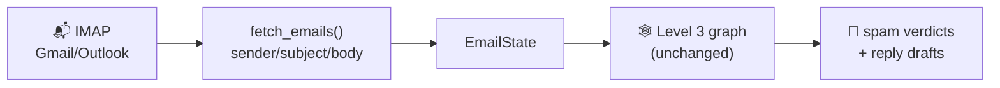

# Level 4 — Your Real Inbox

> **Goal:** take the Level 3 agent and feed it **your real emails** — same graph, real data. Read-only, draft-only, safe.

## The idea

Level 3's agent ran on two hardcoded sample dicts. The entire point of this level: the graph doesn't care where emails come from. Fetch from IMAP → map to the same shape → run:

## The notebook

[40_connect_your_inbox.ipynb](../../../notebooks/level-4-real-inbox/40_connect_your_inbox.ipynb) — connect read-only, fetch a small batch, run the graph, review drafts on screen.

## Setting up email access

### Gmail (recommended for the workshop)

1. Google Account → **Security** → enable **2-Step Verification** (required for app passwords).
2. Security → **App passwords** → create one ("workshop") → Google shows a **16-character password**.
3. In the notebook: `IMAP_HOST="imap.gmail.com"`, `IMAP_USER="you@gmail.com"`, `IMAP_PASSWORD=<app password>`.

> The app password is *not* your login password — it only grants access to mail protocols and can be revoked independently.

### Outlook / Office 365

`IMAP_HOST="outlook.office365.com"` — app passwords work the same way. Some tenants disable them; use a personal account or Gmail for the workshop.

### Any other provider

Anything with IMAP works: your host value + credentials. Common ones: Yahoo `imap.mail.yahoo.com`, Fastmail `imap.fastmail.com`, iCloud `imap.mail.mail.me.com` (app-specific password).

## Safety rules (why draft-only)

| Rule | Why |
|---|---|
| **Read-only connection** (`mail.select(..., readonly=True)`) | Nothing can be marked/moved/deleted even if code is buggy |
| **Drafts printed, never sent** | No SMTP step exists in this workshop — replies stay on your screen |
| **Start with 5–10 emails** | Cost + PII hygiene: each email = 2 LLM calls |
| **Prefer a test label/folder** | Keeps workshop runs away from your real mail flow |
| **Don't paste sensitive mail into endpoints you don't trust** | Your emails go to whatever `OPENAI_API_BASE` you configured — use the instructor endpoint or your own provider |

## How real automation would continue (after the workshop)

The pattern scales in trust levels — each requires more care:

1. **Label instead of print** — IMAP `STORE` to apply a "spam-candidate" label (copy, not move).
2. **Scheduled runs** — cron/GitHub Actions triggering the notebook as a script on `UNSEEN` mail.
3. **Reply sending (SMTP)** — possible, but keep a human review step forever. Auto-send is how you email your entire contact list a Batman draft.

## Coming next

[Level 5 — What Else Can You Automate?](../level-5-next-steps/what-next.md)
