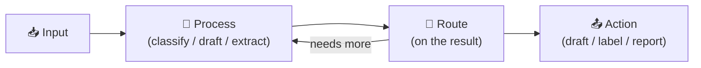

# What Else Can You Automate? 🚀

*The closing deck — patterns you learned → problems you can now solve.*

## You already have the pattern

State → nodes → conditional routing → loop-until-good. Every idea below is this shape with different inputs and actions.

## The pattern → recipe table

| Automate what? | Input | Nodes | Routing | Action |
|---|---|---|---|---|
| **Email triage** (you just built this) | inbox emails | classify, draft | spam / legit | label, draft reply |
| **Customer support** | support tickets | classify intent, draft answer, check policy | urgent / FAQ / refund | route to human, auto-draft |
| **Meeting notes → action items** | transcript text | extract actions, assign owners | has-actions / none | task list, calendar pings |
| **News/RSS digest** | feeds | score relevance, summarize | worth-reading / skip | daily digest email |
| **Job posts → fit scoring** | scraped listings | match vs your profile, score | apply / maybe / skip | tracker row + tailored draft |
| **Invoice/receipt processing** | PDFs/screenshots | extract fields, validate | valid / mismatch | accounting row, flag exceptions |
| **Social scheduling** | draft posts | check tone/policy, pick slot | approve / revise | queue for review |
| **CRM hygiene** | contact records | dedupe, enrich, summarize | update / create / skip | CRM write-back |

## Pick your first solo automation

1. **Pick a boring, repetitive flow you personally do weekly** — that's your target.
2. **Find the input** (emails? a spreadsheet? an API? a folder of files?) — fetch it into state.
3. **Reuse the email-agent shape:** classify → route → draft → human review.
4. **Keep the human-in-the-loop** until you've watched it be right 50 times.

## Where to go next

- [LangGraph docs](https://langchain-ai.github.io/langgraph/) — the framework reference
- [Langfuse](https://langfuse.com) — tracing & evaluation for everything you build
- This repo's [notebooks](../../../notebooks/) — re-run any level anytime
- Build something boring, then automate it. Then come show us.

## Thank you 🙏

Questions → workshop channel / instructor contact.
